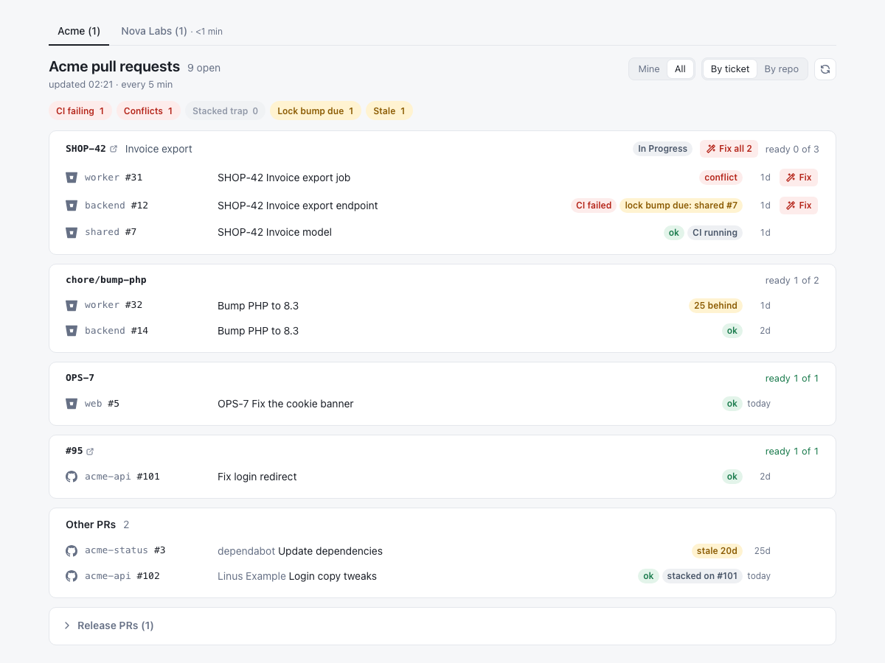

# PR board

A local page that keeps the open pull requests of one or more projects in view, across GitHub and Bitbucket. It groups them by Ticket (`SHOP-42` with its PRs in every repo) or by repository, and shows what decides whether each PR can be merged:

- CI result;
- conflicts;
- commits behind the base branch;
- stacked-PR traps;
- lock updates due on a shared package;
- the Jira status of the Ticket.

Every row links to the PR, so you merge in GitHub or Bitbucket as usual. Blocked PRs get a "Fix" button that copies a prompt for your coding agent.

It is read-only: the collector only sends GET requests upstream. It runs on your machine only, bound to `127.0.0.1`.



## Requirements

- Node 22 or newer. No `npm install`: there are no dependencies.
- macOS is tested. Linux and Windows are **untested, help welcome**: their secret store, config dir and autostart paths come from docs, not from a real machine.
- Read access to the repos you want to see, and tokens for them (see "Tokens").

## Quick start

1. Clone the repo.
2. Create the config dir:

   | OS | Config dir |
   |---|---|
   | macOS, Linux | `$XDG_CONFIG_HOME/pr-board` when `XDG_CONFIG_HOME` is set to an absolute path, else `~/.config/pr-board` |
   | Windows (untested) | `%APPDATA%\pr-board` |

   `PR_BOARD_CONFIG_DIR` (an absolute path) overrides both. The board creates the dir (mode `0700`) when it's missing.
3. Copy the two examples into it:

   ```bash
   mkdir -p ~/.config/pr-board/projects
   cp config.example.json ~/.config/pr-board/config.json
   cp projects/example.json ~/.config/pr-board/projects/acme.json
   ```

   Rename `acme` to your project, both the file and its key under `projects` in `config.json`.
4. Edit both files (see "Project file" and "Personal config"), and store your tokens (see "Tokens").
5. Start it:

   ```bash
   npm start
   ```

6. Open http://127.0.0.1:7419. `/` redirects to the first project, at `/p/<id>`.

Without a `config.json` the board still starts, with no projects, and the page says where to add one.

## Project file

A project file describes one project. It holds nothing personal, so a team can share it. Start from `projects/example.json`, and keep its `"$schema"` line: your editor then autocompletes keys and flags unknown ones.

| Key | Required | Meaning |
|---|---|---|
| `title` | no (default: the id) | Tab and page title. |
| `hosts.github.owner` | at least one host | GitHub org or user. One owner per host. |
| `hosts.bitbucket.workspace` | at least one host | The Bitbucket workspace. |
| `repos.github`, `repos.bitbucket` | no | A list of repo names to show, in that order. Without it, the board discovers the repos (see "Repos and the Bitbucket rate limit"). |
| `aliases` | no | Repo name → short name shown on rows (`"acme-backend": "backend"`). |
| `tickets` | no | Ticket matchers, in order. `{ "prefix": "SHOP", "browse": "https://jira.example.com/browse/{key}", "jira": "main" }` matches `SHOP-42`, `SHOP 42`, `shop_42` and `SHOP42` in the branch, then the title. `browse` is the link (or `null` for none), and `jira` names a site under `jira` to fetch the status from. `{ "link": "trello.com/c/" }` matches the first such URL in the PR description. Without matchers, every PR lands in a branch group or "Other PRs". |
| `jira.<site>.cloudId` | when a matcher names the site | The Jira site's cloud id. |
| `sharedPackages` | no | `[{ "repo", "kind": "composer", "package", "consumers" }]`: turns on the lock checks for a package that other repos pin in `composer.lock`. |
| `fixPrompts.<kind>` | no | Project conventions for fix prompts (see "Fix prompts"). |

A repo reference (`aliases` keys, `sharedPackages.repo`, `consumers`) is a plain repo name. When the same name exists on both hosts, write `github:<name>` or `bitbucket:<name>`.

## Personal config

`config.json` in the config dir is about you: port, timings, token references and which project files to load. Every key is optional.

| Key | Default | Meaning |
|---|---|---|
| `port` | `7419` | Local port. The `PORT` env var wins when it's a valid number. |
| `intervalSec` | `300` | Refresh interval for the project you're looking at. |
| `idleAfterSec` | `900` | After this long without a request, a project counts as not viewed, and the board as closed. |
| `idleIntervalSec` | `3600` | Refresh interval for the other projects while the board is open. |
| `staleDays` | `14` | A PR not updated for longer is "stale". |
| `behindWarn` | `20` | From this many commits behind, "behind" is a warning. |
| `ghPath` | `"gh"` | The `gh` binary (a name on `PATH` or an absolute path). |
| `credentials.github.ref` | `""` | Token reference for GitHub. Empty means `GH_TOKEN`, `GITHUB_TOKEN`, then `gh auth token`. |
| `credentials.bitbucket`, `credentials.jira` | none | `{ "ref", "email" }`: the token reference and your Atlassian email. |
| `projects.<id>.file` | required | Path to the project file. A relative path resolves against the config dir. |
| `projects.<id>.credentials.<host>` | none | Credential override for that project, same shape as the global one. |
| `mine.github`, `mine.bitbucket` | detected | Override who "Mine" means (GitHub login, or Bitbucket account uuid). |
| `fixNotes.all`, `.github`, `.bitbucket` | none | Notes added to every fix prompt as a closing "My setup:" paragraph. |

The project id (the key under `projects`) must match `^[a-z0-9][a-z0-9-]*$`; it becomes the URL `/p/<id>`. Tabs follow the order of the keys.

**Credential overrides.** A project whose repos need another account gets its own `credentials`. An override replaces the global credential for that host. When it finds no token, that project shows a "no token" error; it never falls back to your global GitHub identity.

**Fix notes.** Put your tooling (which CLI or MCP reads pipelines, how you run tests) in your own agent instructions first, where every prompt benefits. Use `fixNotes` only as a fallback for what the agent can't know otherwise.

**Errors.** A broken `config.json` never stops the board: it starts with an error banner. A broken project file stops only that project: its tab shows the error (file, JSON path, what's wrong), and the other projects keep running. Unknown keys show as a warning on the tab.

Config is read at start. Restart the board after a change (see "Run at login").

## Tokens

The board never reads a token from a file of its own, and never writes one to config, logs, errors or the page.

### The chain

For a credential with reference `R`, the board tries, in order, and takes the first non-empty answer:

1. **OS store**, entry `R`: Keychain (macOS), Secret Service through `secret-tool` (Linux, untested), Credential Manager (Windows, untested).
2. **Env var** derived from `R`: uppercase, every non-alphanumeric character becomes `_`. `acme-bitbucket` → `ACME_BITBUCKET`. It holds the token only.
3. **Global GitHub only** (no override): `GH_TOKEN`, then `GITHUB_TOKEN`, then `gh auth token`.

The Atlassian email always comes from `email` in the credential.

### Storing a token

| OS | Command |
|---|---|
| macOS | Copy the token, then `security add-generic-password -U -a "$USER" -s <ref> -w "$(pbpaste)"`, then `pbcopy < /dev/null` to clear the clipboard. |
| Linux (untested) | `secret-tool store --label=<ref> service <ref>`. It prompts. Never pipe the token in with a trailing newline: the newline gets stored. |
| Windows (untested) | `cmdkey /generic:<ref> /user:token /pass`. It prompts. |

On macOS, don't use the interactive prompt (`-w` without a value): it silently cuts the token at 128 characters, and Atlassian tokens are about 192.

### Scopes

- **GitHub**: a fine-grained personal access token with read access to Metadata, Contents (for the `composer.json` and `composer.lock` reads), Pull requests and Actions. No Checks permission is needed: CI comes from Actions runs. `gh`'s own token works too, so with `gh auth login` done you need no GitHub store entry at all.
- **Bitbucket**: an Atlassian API token with scopes (https://id.atlassian.com/manage-profile/security/api-tokens, "Create API token with scopes"): `read:repository:bitbucket`, `read:pullrequest:bitbucket`, `read:pipeline:bitbucket` and `read:user:bitbucket`.
- **Jira**: a second scoped API token with `read:jira-work`. Scoped tokens only work through `api.atlassian.com`, which the board uses.

`gh` without a keyring (or with `--insecure-storage`) keeps its token in a plain-text file of its own. That's `gh`'s storage and your choice; the board only runs `gh auth token`.

WSL counts as headless Linux: run the board from a terminal with env vars, or run it natively on Windows.

## Repos and the Bitbucket rate limit

Without `repos.<host>`, the board discovers the repos your token can see, at most once an hour: GitHub org repos, or for a user the token's own repos (private ones too) when the token belongs to that user and else their public repos, without forks, archived or disabled ones, and Bitbucket workspace repos without forks.

With `repos.<host>`, it shows exactly that list. A listed repo that discovery didn't return gives a warning ("`acme-web` not found, or the token can't see it").

Bitbucket allows about 1,000 requests an hour per API token, and every repo costs requests each round. Without a list, the board takes at most the **40** most recently updated Bitbucket repos and warns: "Showing 40 of 112 Bitbucket repos (rate limit). Add a repo list to choose which." For a large workspace, add a list. GitHub has no cap.

`aliases` gives repos a short name on the rows.

## Fix prompts

A PR with a fixable signal gets a "Fix" button, and a Ticket or branch group with two or more gets "Fix all". The prompt is copied to the clipboard for your coding agent.

| Key | When it fires | What the default already says |
|---|---|---|
| `conflict` | The PR has a merge conflict. | Merge (not rebase) the target in, resolve keeping both intents, run the tests, push. |
| `ci-failed` | CI failed. | GitHub: read the failing run with `gh run list` / `gh run view --log-failed`. Bitbucket: read the failing pipeline. Find the root cause, say so if it's flaky or infra, push. |
| `base-retarget` | A stacked PR's base PR was merged or closed (GitHub). | Check the base reached the default branch, retarget (`gh pr edit --base`), merge the default branch in, push. |
| `base-no-pr` | The target branch has no PR of its own. | Find out whether the target needs a PR or this one should target the default branch; ask before retargeting. |
| `lock-unpin` | `composer.json` pins a shared package branch whose PR is merged. | Set the constraint back to the shared default branch and update the lock to its head. |
| `lock-missing` | A merged shared package PR of the same Ticket isn't in the lock yet. | Update the package in the lock to the shared default branch head, push, let CI build. |
| `lock-pinned` | `composer.json` pins a shared package branch with no PR. | Find out whether that branch was merged, renamed or abandoned, and report back first. |
| `group` | Any "Fix all" prompt. | The order: shared package repos, then their consumers, then the rest; one commit per repo. |

A project's `fixPrompts.<kind>` appends a "Project convention:" line under that step. It narrows how the step is done and never replaces the default. Every prompt ends by asking the agent to read the repo's `AGENTS.md` or `CLAUDE.md` first, never force-push, and report the commit and CI result.

## Run at login

```bash
node scripts/install.js
```

| | macOS | Linux (untested) | Windows (untested) |
|---|---|---|---|
| Unit | launchd agent `~/Library/LaunchAgents/io.github.sanderhouttekier.pr-board.plist` | systemd user unit `pr-board.service`, or `~/.config/autostart/pr-board.desktop` without systemd (no crash restart) | scheduled task `pr-board` |
| Logs | `~/Library/Logs/pr-board.log` | `journalctl --user -u pr-board` | none |

The unit runs your current `node` (nvm is fine) with your config dir baked in, and restarts the board when it crashes. Run the installer again after you switch Node versions. On Windows the task runs through `cmd.exe` and may show a console window (untested).

Flags:

- `--print` prints the unit and changes nothing;
- `--uninstall` removes it;
- `--url` prints the board URL with the configured port.

**Refusal.** Before it writes anything, the installer loads your config and every project file. It refuses (exit 1, writes nothing) when a project file is broken, or when a token a project needs isn't in the OS store (or, for the global GitHub identity, `gh auth token`). Env vars don't count, because a board started at login can't see your shell profile. It prints each missing reference with the command to store it, never a token.

**After a config change**, restart the board: run `node scripts/install.js` again, or on macOS:

```bash
launchctl kickstart -k gui/$(id -u)/io.github.sanderhouttekier.pr-board
```

For one-click access, open the page in Chrome and pick ⋮ → Cast, save and share → **Install page as app**, or in Safari use File → **Add to Dock**.

## How it refreshes

- The project you're looking at refreshes every `intervalSec` (5 min), plus a quick follow-up 15 s later while GitHub hasn't computed mergeability yet.
- Other projects refresh every `idleIntervalSec` (hourly) while the board is open in a visible tab.
- With no page open (or only hidden tabs) for `idleAfterSec`, the board makes no calls at all. After login nothing is fetched until you open the page.
- Opening a project whose data is older than `intervalSec` refreshes it at once; you see "updating…" for a few seconds.
- The page polls the local server every 30 s while its tab is visible. The refresh button starts a round straight away.
- The header says when the next round is due ("next 10:36"). The refresh button counts down to it: its border drains, and its icon redraws itself about once a minute to show the board is live.
- If a source fails, the page keeps that source's last good data and shows a banner with the error.

## What the page shows

- **Project tabs** (with two or more projects): "Acme (2)" counts your PRs that need attention. A tab on the hourly rate adds the data's age ("· 40 min"). "!" in the warning colour means that project has an error; open the tab to read it.
- **Attention chips**: CI failing, Conflicts, Stacked trap, Lock bump due, Stale. Click one to filter.
- **Mine / All** and **By ticket / By repo** toggles, remembered in the browser.
- **By ticket**: one card per Ticket, with its link, the Jira summary and status (when the matcher names a Jira site) and "ready N of M". PRs without a Ticket that share a branch form a card named after the branch; the rest are in "Other PRs". Release PRs (develop → main and similar) are folded away at the bottom.
- **By repo**: one row per repo with open and mine counts and the worst problem.
- **Signals per PR**: CI ok/failed/running, mergeable or conflict, "N behind", stacked on another PR (with "base merged: retarget" on GitHub; Bitbucket retargets by itself), the shared package lock signals, stale, draft and age.
- **Warnings** (unknown keys, repos not found, the Bitbucket cap) show as a muted list under the chips.

A PR is **ready** when it isn't a draft, CI is ok (or absent), it has no conflict, and no warning applies.

## Troubleshooting

| Symptom | Cause |
|---|---|
| "No Bitbucket token for `acme-bitbucket`: tried …" | The chain found nothing. The message lists every source it tried. Store the token (see "Tokens"). |
| "… started at login: env vars from your shell profile aren't visible here" | The board runs from the login agent, which doesn't see `GH_TOKEN` or other env vars from your profile. Put the token in the OS store. |
| Bitbucket or Jira 401 | The token is truncated (stored via the interactive macOS prompt), expired, lacks a scope, or `email` isn't your Atlassian email. |
| Bitbucket 429, or "Showing 40 of N Bitbucket repos" | The Bitbucket rate limit. Add `repos.bitbucket` with the repos you need. The page keeps the last good data meanwhile. |
| GitHub PRs show mergeable as unknown | GitHub computes mergeability lazily. The follow-up round 15 s later fills it in. |
| A tab shows "!" or an error instead of PRs | That project's file or credential is broken. The error names the file, the JSON path and the problem; the other projects keep running. |
| An error banner on every tab | `config.json` is invalid. Fix it and restart. |

## Development

See `CLAUDE.md` for the rules (read-only upstream, test-first, no dependencies), `docs/SPEC.md` for the design, `GLOSSARY.md` for terms and `filemap.md` for where things live.

```bash
npm test
PORT=7431 node scripts/dev-stub.js   # the page over made-up projects, no tokens or network
```

## Licence

MIT, see `LICENSE`.
